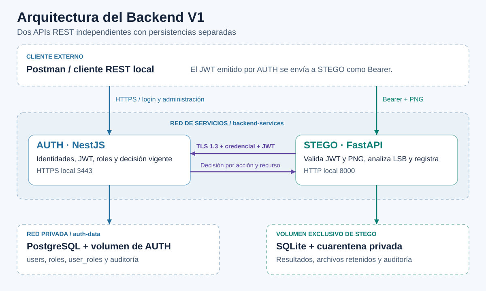
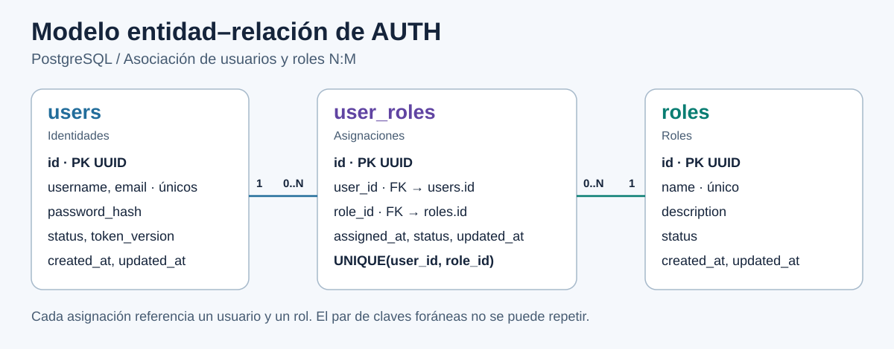

# Arquitectura e integración del Backend V1

[Imagen SVG de arquitectura](diagramas/arquitectura-auth-stego.svg).

AUTH y STEGO se ejecutan como procesos y contenedores separados, con sus propias rutas, configuración y guías. NestJS permite reutilizar la base del taller y organizar validación, lógica y persistencia. FastAPI permite manejar el contrato REST junto a Pillow, NumPy y SciPy. SQLite mantiene los resultados y la propiedad de los análisis en STEGO. PostgreSQL mantiene las identidades y la auditoría de AUTH en la red privada `auth-data`.

## Modelo entidad–relación de AUTH

[Imagen SVG del modelo entidad–relación](diagramas/modelo-entidad-relacion-auth.svg).

Un usuario puede recibir cero o más asignaciones y un rol puede figurar en cero o más asignaciones. Cada asignación apunta a un usuario y un rol mediante claves foráneas obligatorias. `user_roles.id` identifica la asignación y `UNIQUE(user_id, role_id)` impide duplicarla. El diagrama destaca los campos exigidos por la consigna y los campos que intervienen en el control de sesión. La API usa algunos nombres en español y la base conserva los nombres físicos que aparecen en la imagen.

- Entidades [User](../ms-users/src/users/entities/user.entity.ts), [Role](../ms-users/src/roles/entities/role.entity.ts) y [UserRole](../ms-users/src/user-roles/entities/user-role.entity.ts).
- [Migración del modelo AUTH V2](../ms-users/src/database/migrations/1793664000000-AuthV2.ts).
- [Docker Compose del conjunto](../docker-compose.yml), [guía AUTH](../ms-users/README.md) y [guía STEGO](../ms-stego/README.md).

## Comprobación de independencia

Desde la carpeta `App`, `node scripts/compose.cjs stop stego` permite seguir consultando la salud de AUTH. `node scripts/compose.cjs start stego` vuelve a iniciar su contenedor. Si se detiene AUTH, la salud de STEGO sigue respondiendo y su ruta de análisis devuelve 503. El [guion de sustentación](05_guion_sustentacion_postman.md) indica el orden de estas operaciones.
