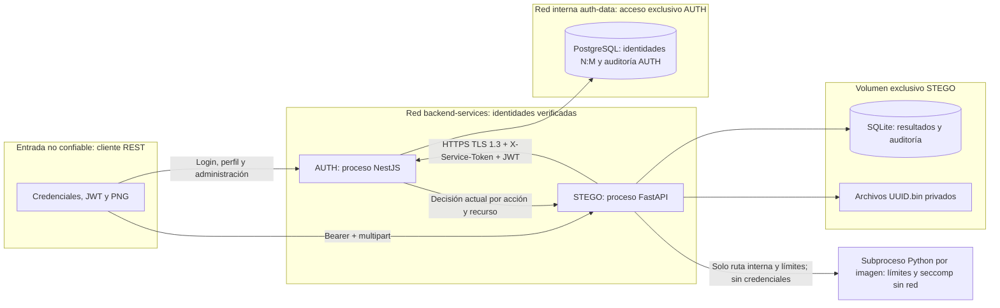

# Arquitectura e integración del Backend V1

AUTH y STEGO tienen imágenes, procesos, configuraciones, APIs y documentación independientes. NestJS aprovecha el microservicio del taller y sus capas de validación/persistencia. FastAPI permite manejar el contrato REST en Python; Pillow decodifica PNG, NumPy calcula el histograma y SciPy la cola chi-cuadrado. SQLite mantiene la propiedad de resultados sin acceder a PostgreSQL de identidades. No hay importación de código entre servicios.

El [modelo ER de AUTH](../ms-users/docs/AUTH_V2.md#modelo-entidad-relación) conserva `users`, `roles` y `user_roles`, PK propias, FK y unicidad del par. PostgreSQL solo comparte red con AUTH. STEGO no recibe credenciales de esa base, claves privadas JWT/TLS ni la clave privada de la CA. Recibe la clave pública JWT, la CA y una credencial aleatoria exclusiva del servicio.

## Flujo de decisión

1. AUTH verifica credenciales con Argon2id y emite JWT RS256 de vigencia acotada. La privada RSA permanece en AUTH.
2. STEGO verifica localmente firma RS256, emisor, audiencia, expiración, tipo de acceso, identificador UUID, versión y duración del token. No usa roles enviados por el cliente.
3. Antes de leer el cuerpo multipart, STEGO consulta `POST https://auth:3443/internal/authorization/check`, enviando JWT y acción, con `X-Service-Token`. El certificado se verifica con la CA y TLS mínimo 1.3.
4. AUTH vuelve a comprobar sesión, usuario, roles y asignaciones activos desde PostgreSQL. Para lectura, STEGO aporta el propietario obtenido de su SQLite, nunca del cliente.
5. STEGO exige que la respuesta coincida en sujeto, acción y recurso y que `allowed` sea un booleano real. No almacena decisiones como permisos permanentes. Denegación → 403; JWT/sesión inválidos → 401; indisponibilidad de AUTH → 503; decisión mal formada → 502. No procesa el archivo sin permiso comprobado.
6. Una vez autorizado, valida el archivo, ejecuta el trabajador aislado y conserva métricas reales, SHA-256, propietario, fecha y política. La consulta posterior repite la autorización por recurso.

El endpoint interno requiere TLS real y la identidad de servicio; un JWT del usuario por sí solo no lo habilita. La credencial compartida identifica al servicio; no se presenta como mTLS. El cliente STEGO valida el certificado servidor y no sigue redirecciones. La ventana entre la decisión y la operación no desaparece: la revocación se hace efectiva en la siguiente decisión, sin prometer cancelar trabajos ya autorizados.

## Matriz de permisos

| Operación | ADMIN | ANALYST | USER |
|---|---|---|---|
| Login con credenciales válidas | Sí | Sí | Sí |
| Perfil y logout propios | Sí | Sí | Sí |
| CRUD de usuarios y roles; asignar/retirar roles | Sí | No | No |
| Analizar un PNG | Sí | Sí | No |
| Consultar resultados propios | Sí | Sí | No |
| Consultar resultados ajenos | Sí | No | No |
| Endpoint interno de decisiones | Solo cliente de servicio autenticado; vuelve a evaluar al usuario | Igual | Igual |

La acumulación de roles aplica los permisos efectivos actuales, sin elevar a USER por enviar cabeceras falsas. Un ANALYST que pierde su asignación deja de poder analizar con el mismo JWT. El logout incrementa la versión de tokens del usuario; este mecanismo invalida sus tokens previos, no solamente un token individual.

## Límites operativos

Los puertos de desarrollo se restringen a loopback. El canal interno usa HTTPS; STEGO expone HTTP local, por lo que el despliegue remoto requiere TLS de entrada. La red de servicios permite salida para operar; el trabajador de imágenes tiene las llamadas de red denegadas con seccomp. El contenedor no es privilegiado, no tiene capacidades y usa sistema raíz de solo lectura. El trabajador comparte el UID y el volumen de STEGO: este aislamiento limita recursos y red, pero no constituye una frontera completa frente a una vulnerabilidad que permita leer archivos del propio servicio. Mantener dependencias actualizadas y evaluar un aislamiento de filesystem más estricto para producción.

Cada instancia STEGO está limitada a dos trabajos; SQLite y el volumen local corresponden a esta entrega de una sola instancia. Las credenciales y certificados necesitan gestión y rotación; no se incluye una plataforma de secretos ni alta disponibilidad.
