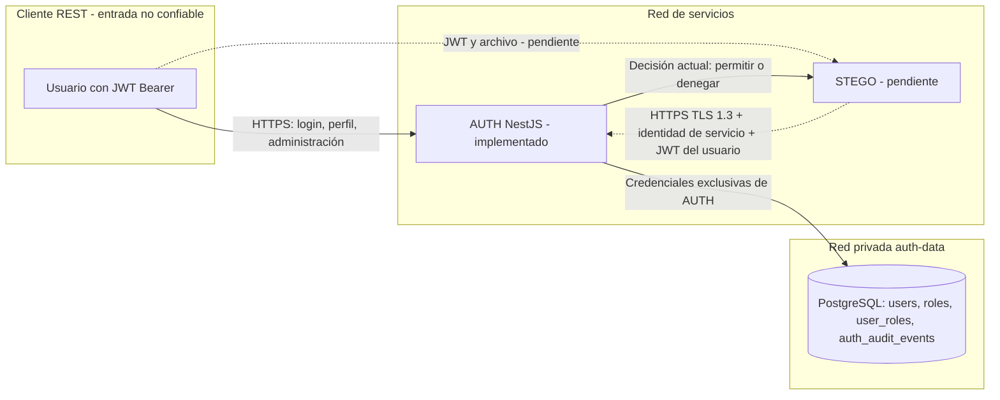
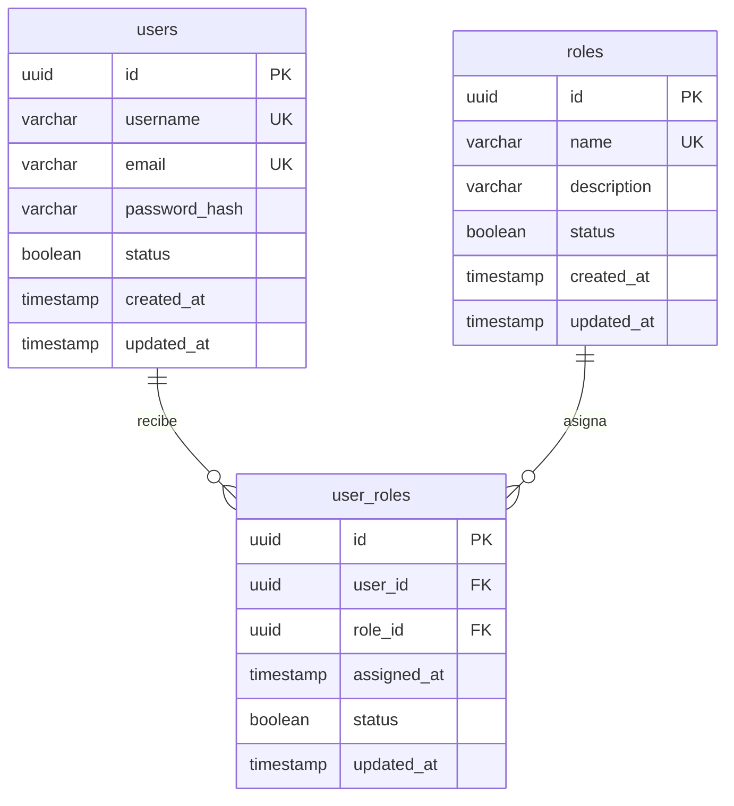

# AUTH V2 - Backend del primer parcial

> Informe histórico de la fase AUTH V2. STEGO y la integración ya están implementados en la fase posterior: consultar la [arquitectura actual](../01_arquitectura_y_modelo_datos.md) y sus [pruebas reales](../04_pruebas_y_evidencias.md). Las referencias a STEGO pendiente describen únicamente el estado de aquella fase.

Fecha local de implementación: 02/11/2026. Este documento describe el microservicio AUTH implementado en App/ms-users. STEGO todavía no está implementado. El contrato interno se probó con un cliente HTTPS de pruebas; no se presenta esa prueba como una integración con STEGO real.

## Responsabilidad y límites de confianza

NestJS/TypeScript y PostgreSQL reutilizan la base del taller y permiten separar controladores, validación, lógica de identidad y persistencia. RS256 permite verificar en otro servicio sin entregarle capacidad de firmar. HTTPS con TLS 1.3 protege la consulta interna; una credencial aleatoria identifica a STEGO. La red de base de datos solo conecta PostgreSQL con AUTH.



El tramo punteado es un contrato preparado para la siguiente implementación. STEGO deberá verificar el JWT con jwt-public.pem, consultar AUTH en cada operación y rechazar la operación ante allowed=false, errores de red/TLS, respuestas inválidas o AUTH no disponible. No se le entregarán claves privadas ni acceso a PostgreSQL de AUTH.

## Modelo entidad-relación



UNIQUE(user_id, role_id) impide duplicados incluso con solicitudes concurrentes. Las FK mantienen la integridad N:M. Se conservan los datos adicionales del taller (cédula, nombres, apellidos, fecha de nacimiento, teléfono, version y eliminación lógica). Las propiedades de la API conservan `rol`, `estado`, `fechaCreacion`, `fechaActualizacion` y `fechaAsignacion`; sus columnas se mapean a `name`, `status`, `created_at`, `updated_at` y `assigned_at`. La API recibe `password`, pero solo se almacena `password_hash` y no se retorna el hash.

## Matriz de permisos

| Operación | ADMIN | ANALYST | USER |
|---|---|---|---|
| Login con credenciales válidas | Sí | Sí | Sí |
| Perfil propio y logout | Sí | Sí | Sí |
| Crear, consultar, actualizar y eliminar usuarios | Sí | No | No |
| Crear, consultar, actualizar y eliminar roles | Sí | No | No |
| Asignar, listar y retirar asignaciones | Sí | No | No |
| Decisión para steganography.analyze | Permitir | Permitir | Denegar |
| Decisión para steganography.results.read propio | Permitir | Permitir | Denegar |
| Decisión para steganography.results.read ajeno | Permitir | Denegar | Denegar |

Los dos últimos grupos son decisiones implementadas en AUTH; la aplicación efectiva en las rutas de STEGO está pendiente. Definir las políticas en código no asigna privilegios a usuarios: las asignaciones reales se consultan en PostgreSQL en cada solicitud. Se filtran usuarios, roles y asignaciones inactivos o eliminados. Los roles antiguos CLIENTE/OPERADOR no conceden privilegios administrativos ni de análisis en esta versión.

## JWT y cierre de sesión

- Argon2id protege contraseñas. Login consulta username/email normalizados y devuelve un mensaje genérico para credenciales incorrectas. El hash ficticio reduce diferencias temporales por usuarios inexistentes.
- Solo RS256 está permitido. Las claves RSA son de 3072 bits y se comprueba que formen un par. AUTH conserva la privada; la pública se puede distribuir a STEGO. El token contiene sub, username, tokenVersion, typ=access, iat, exp, iss y aud; no contiene roles como autoridad de permisos.
- El vencimiento se configura entre 60 y 3600 segundos (900 por defecto). Se comprueban firma, algoritmo, emisor, audiencia, expiración, sujeto UUID y tipo de token.
- El perfil y cada consulta interna vuelven a leer identidades y roles vigentes. Logout incrementa token_version; todos los tokens anteriores de esa cuenta quedan inválidos. Los tokens HS256 de la versión anterior dejan de ser válidos: se requiere iniciar sesión otra vez.
- Las rutas públicas de AUTH son health y login. La consulta interna omite el guard de usuario convencional porque utiliza otro contrato, pero exige su propio guard de identidad de servicio y TLS, y luego valida el JWT del usuario.

## Contrato interno para STEGO

Ruta exacta: `POST https://auth:3443/internal/authorization/check` dentro de Compose. Desde el host: `https://localhost:3443/internal/authorization/check`.

Cabeceras: Content-Type application/json y `X-Service-Token: <STEGO_SERVICE_TOKEN>`. La credencial se genera aleatoriamente, tiene al menos 256 bits y se compara en tiempo constante. El servicio no confía en X-Forwarded-Proto: el socket debe ser TLS real.

Solicitud de análisis:

```json
{"subject_token":"<JWT_USUARIO>","action":"steganography.analyze","resource_id":null}
```

Solicitud de lectura de resultados:

```json
{"subject_token":"<JWT_USUARIO>","action":"steganography.results.read","resource_id":"<UUID_ANALISIS>","resource_owner_id":"<UUID_PROPIETARIO>"}
```

**resource_owner_id debe obtenerlo STEGO de su registro persistido**, nunca de una cabecera o campo suministrado por el cliente. El campo extiende el ejemplo del anexo B para decidir sobre propiedad sin dar a AUTH acceso directo al almacenamiento de STEGO. STEGO debe comprobar que el recurso solicitado existe y corresponde a ese propietario.

Respuesta HTTP 200 para un usuario válido, tanto al permitir como al denegar:

```json
{"subject_id":"<UUID_USUARIO>","action":"steganography.analyze","resource_id":null,"allowed":true,"reason":"active_role_grants_permission"}
```

Para una denegación: allowed=false y reason=active_role_does_not_grant_permission. Usuario/token o servicio no autenticado: 401. Solicitud malformada o acción desconocida: 400. Falta de permiso en las rutas administrativas públicas: 403. Error de infraestructura: error, nunca una decisión allowed=true. STEGO deberá transformar la decisión denegada en 403 para su cliente y no procesar el archivo. No se debe reutilizar una decisión como permiso permanente.

## API pública y OpenAPI

Base de desarrollo: http://localhost:3001/api/v1; base HTTPS: https://localhost:3443/api/v1. El HTTP publicado está limitado a loopback para desarrollo; usar HTTPS para transmitir credenciales o JWT fuera de ese contexto.

| Método | Ruta | Acceso |
|---|---|---|
| GET | /api/v1/health | Público |
| POST | /api/v1/auth/login | Público; 5 intentos/minuto/IP |
| GET | /api/v1/auth/profile | Autenticado |
| GET | /api/v1/auth/me | Alias de compatibilidad, autenticado |
| POST | /api/v1/auth/logout | Autenticado; 204 |
| POST, GET | /api/v1/users | ADMIN |
| GET, PATCH, DELETE | /api/v1/users/:id | ADMIN |
| GET | /api/v1/users/cedula/:cedula | ADMIN |
| POST, GET | /api/v1/roles | ADMIN |
| GET, PATCH, DELETE | /api/v1/roles/:id | ADMIN |
| POST | /api/v1/user-roles | ADMIN |
| GET | /api/v1/user-roles/user/:userId | ADMIN |
| DELETE | /api/v1/user-roles/:id | ADMIN; id de la asignación; 204 |
| POST | /internal/authorization/check | Credencial de STEGO sobre TLS y token del usuario en el body |

Validación estricta y rechazo de propiedades inesperadas; UUID válidos; paginación de 1 a 100 registros. Los nombres de roles se normalizan a mayúsculas; un CHECK de PostgreSQL impide guardar variantes en minúsculas por SQL directo. Username/email se normalizan a minúsculas.

El [contrato OpenAPI vigente](../contratos/openapi-auth.json) documenta AUTH. Swagger de desarrollo está en /docs y /docs-json. La [colección conjunta](../pruebas/backend-v1.postman_collection.json) contiene las solicitudes; configurar los valores locales de seed_password y service_token, y confiar en secrets/ca.crt en el cliente REST. No desactivar la comprobación de certificados. No exportar ni compartir los valores locales de esas variables o del access_token.

## Auditoría

`auth_audit_events` registra fecha UTC, request_id, actor_id cuando se pudo autenticar, identidad de servicio, método, patrón de ruta, código HTTP y, para decisiones internas, acción, recurso y allowed. No guarda body, cabeceras Authorization, contraseñas, claves ni tokens completos. Se incluyen rechazos producidos por guards. La muestra `auditoria-ejemplo.json` procede de la ejecución temporal de Compose y se comprobó que no contenga credenciales ni tokens.

Los eventos se escriben al terminar la respuesta y se esperan las escrituras pendientes en el cierre controlado. Un error de persistencia de auditoría deja un aviso genérico; no se afirma durabilidad frente a una terminación abrupta. Los análisis y su auditoría en STEGO siguen pendientes.

## Migraciones y datos existentes

La migración inicial publicada no se reescribe. AuthV21793664000000 renombra las columnas al modelo del parcial, añade descripción de roles, convierte user_roles a id propio más UNIQUE de la pareja y crea auditoría. Fue probada sobre registros ya existentes y con reversión. `synchronize` sigue desactivado.

Respaldar una base existente antes de migrar. Si existen tablas sin historial de migraciones de este proyecto, la migración inicial se detiene: reconciliar ese caso explícitamente, sin borrar datos para forzar el arranque. Una reversión de V2 elimina la tabla de auditoría y los campos nuevos; requiere respaldo si se necesitan conservar.

La siembra de desarrollo crea ADMIN/ANALYST/USER y cinco cuentas. No cambia contraseñas ni privilegios de cuentas existentes. Tras actualizar una base del taller, un ADMIN debe asignar expresamente los roles nuevos a las cuentas que correspondan. No se promueve automáticamente a antiguos OPERADOR/CLIENTE. La siembra está bloqueada en producción.

## Evidencias y límites de esta implementación

- `pruebas-auth-v2.txt`: 32 pruebas de integración con PostgreSQL 18 temporal y solicitudes HTTP/HTTPS, sin omisiones.
- Siete pruebas unitarias y lint, además de compilación.
- `verificacion-compose.json`: construcción/arranque y consultas sobre la imagen de AUTH y una base temporal aislada.
- `auditoria-ejemplo.json`: eventos depurados de esa verificación.
- La consulta interna se probó con un cliente HTTPS que usa la credencial de STEGO; no existe todavía un microservicio STEGO ejecutando análisis.
- La revocación se verificó tanto como decisión interna denegada como 403 en una operación administrativa con el mismo JWT. El T07 de integración completa con STEGO se mantiene pendiente por prudencia.

Zero Trust se concreta en validar identidad y estado en cada solicitud y autenticar al servicio. Secure by Design se concreta en FK/UNIQUE/CHECK, mínimo privilegio, secretos fuera del repositorio y firma/canal separados. Shift Left Security se concreta en validaciones y pruebas automatizadas previas a incorporar STEGO. Son controles relacionados con los principios de ISO/IEC 27001 e ISO/IEC 27034; no se afirma certificación ni cumplimiento integral. La matriz de riesgos completa del proyecto se actualizará junto con STEGO y las evidencias restantes.
